<p align="center">
  
</p>

<p align="center">
  <b>An LED flight board for the planes landing over your house.</b><br>
  Live ADS-B on a 128×64 LED panel: each arrival flies in, counts down to the
  runway and lands in the real sky, day or night, rain or shine; departures
  take off; between them, a map, an arrivals board, the weather, today's
  stats, the holding stacks and the last flight's route on a globe. Aircraft
  over your house and the ones on your watchlist cross the sky, with alerts
  on your phone and sensors in Home Assistant.<br>
  Heathrow out of the box, and around fifty more airports a click away.
</p>

<p align="center">
  <a href="https://github.com/SamHoughton/Glideslope/releases/latest"></a>
  <a href="https://github.com/SamHoughton/Glideslope/actions/workflows/build.yml"></a>
  <a href="LICENSE"></a>
  
</p>

<p align="center">
  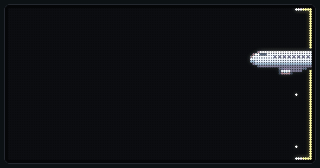
</p>

Recorded from the board's own frames with its built-in showcase (the
fictional flight GS101, in Glideslope's colours). Real cards carry the
airline's logo, which you supply yourself: logos are not part of this
repository (see [Airline logos](#airline-logos)).

| New aircraft flies in | Touchdown |
| --- | --- |
| 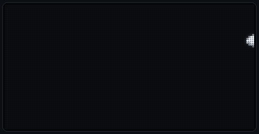 | 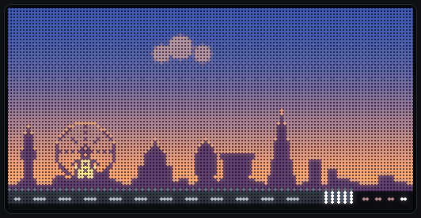 |

| Take-off | Arrivals board |
| --- | --- |
| 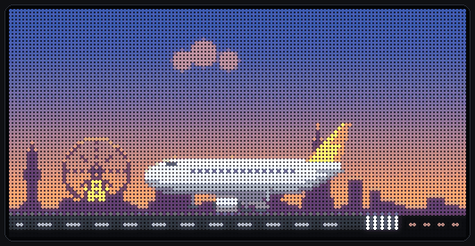 | 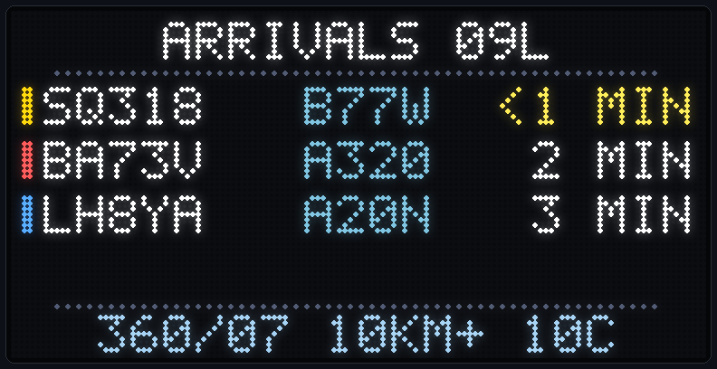 |

| Weather | Today's stats |
| --- | --- |
| 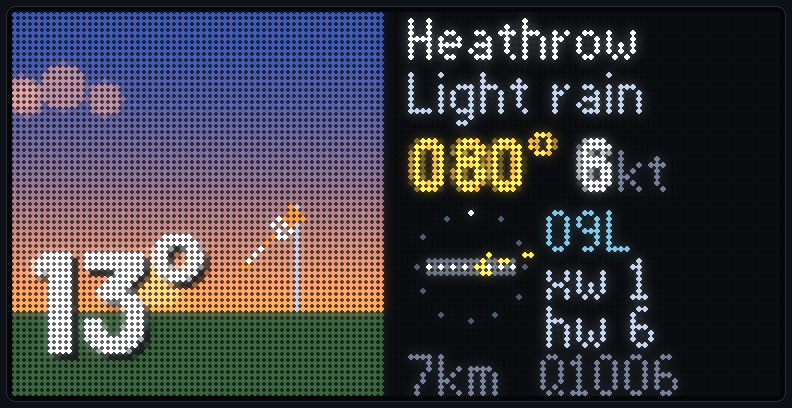 | 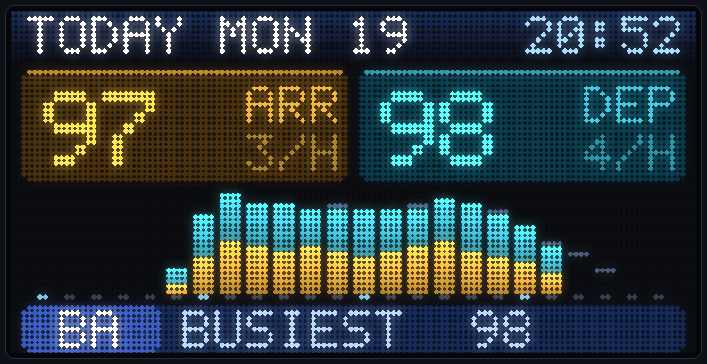 |

| Holding stacks | Emergency squawk |
| --- | --- |
| 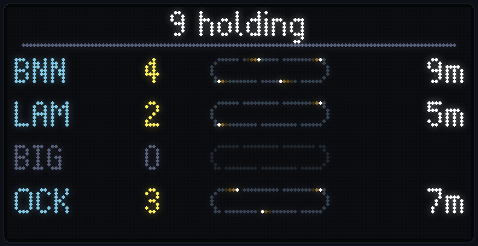 | 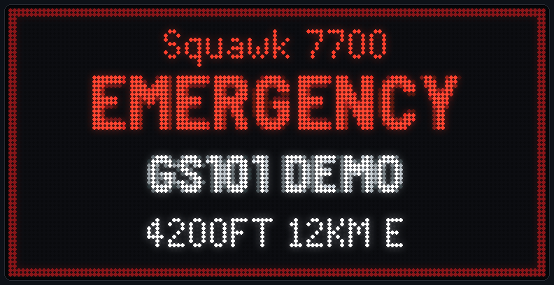 |

| Runway change | Rain at night: the landing lights' beam |
| --- | --- |
| 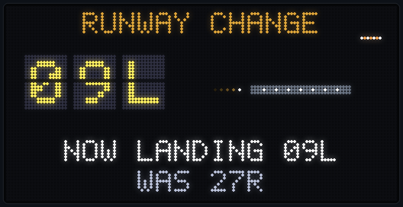 | 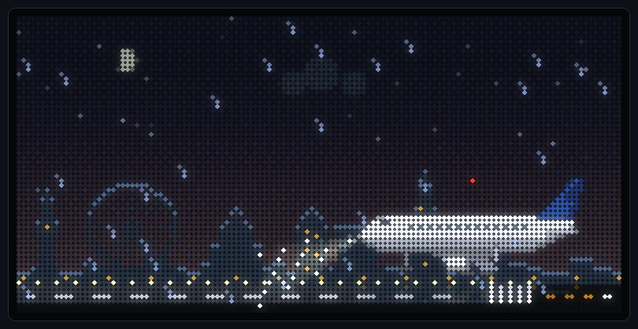 |

| Map, with flight numbers and the spotlight | More on final: the aircraft |
| --- | --- |
| 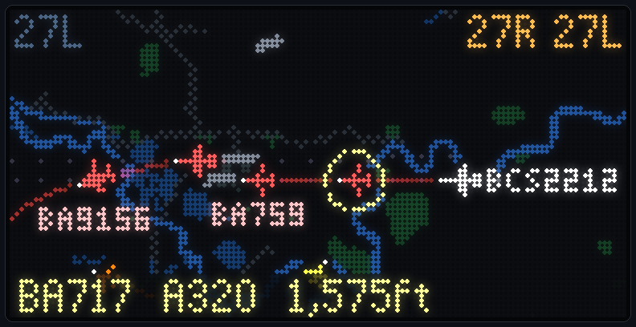 | 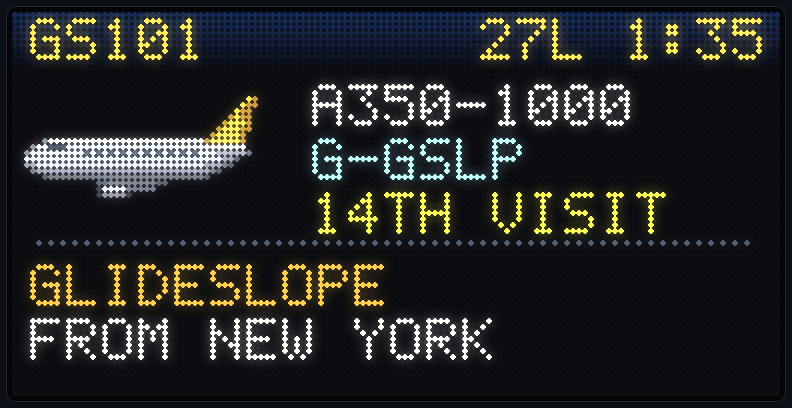 |

| Route globe | Overhead |
| --- | --- |
| 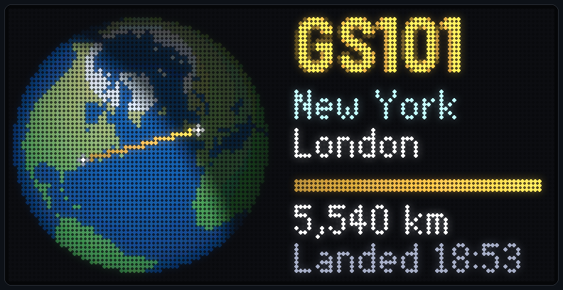 | 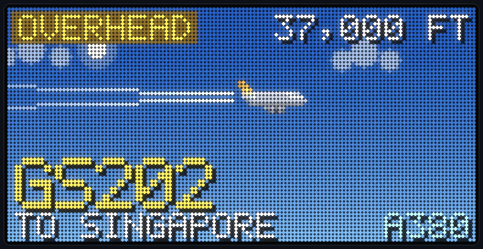 |

| Top airlines | Aircraft types |
| --- | --- |
| 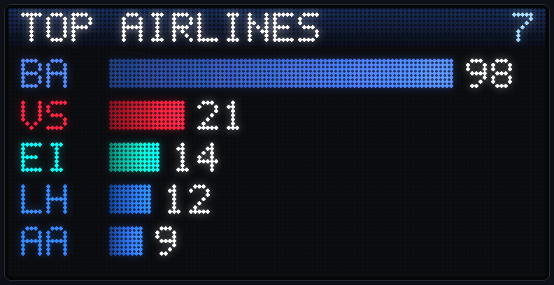 | 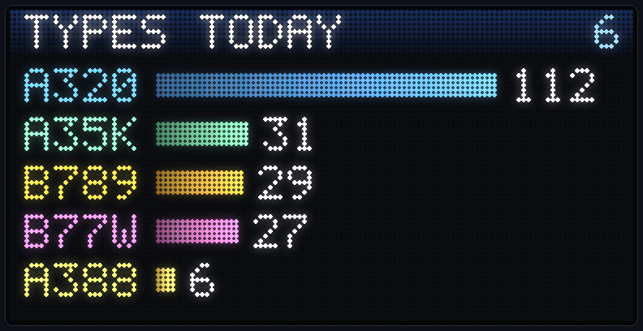 |

The runway change, the rain, the overhead pass, the aircraft page, the top
airlines and types pages and the fireworks below are drawn by the
firmware's own code on a desktop
(`tools/host_build.py render`), with a made-up day of traffic; the rest
are the board's own frames.

### The web page

Every board serves a page at `http://glideslope.local/`: a live mirror of the
panel drawn as glowing LEDs, what's on it now, the animations on demand, every
setting in tabs (display with a switch for each screen, airport, night, data,
spotter, phone alerts and Home Assistant, system, log), firmware updates and a log.

| Desktop | Phone |
| --- | --- |
| 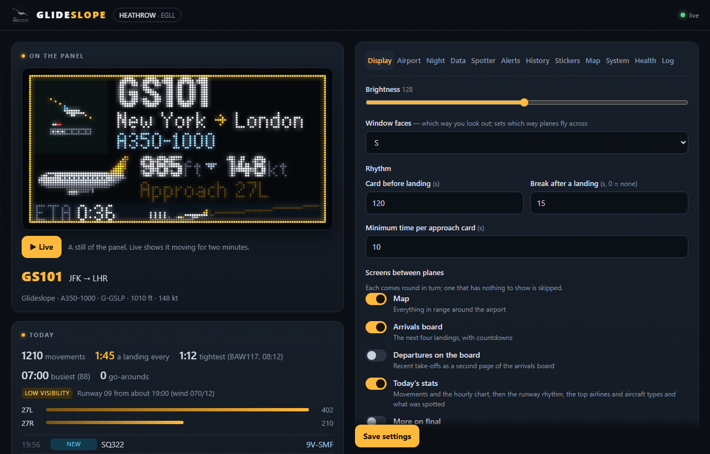 | 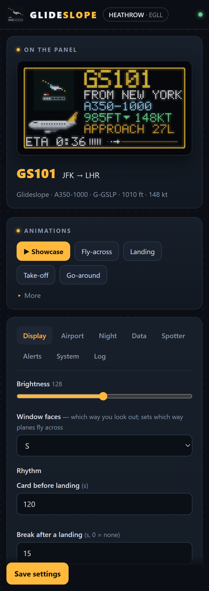 |

| Alerts | Spotter |
| --- | --- |
| 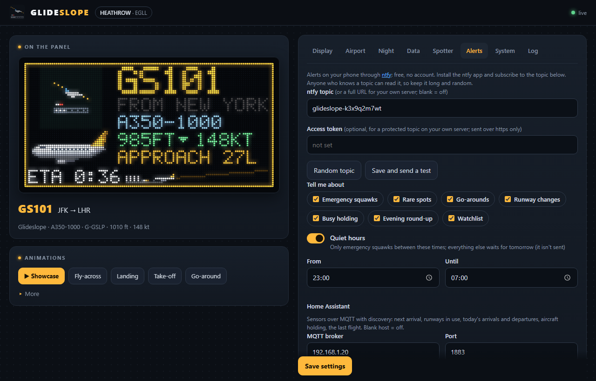 | 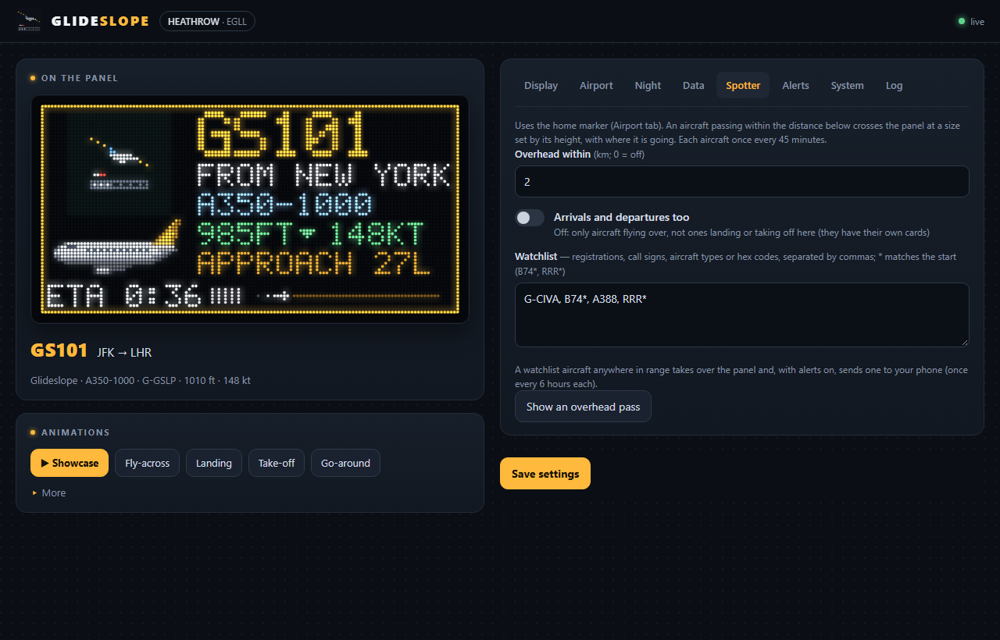 |

## What it shows

- **Approach card**: airline logo, the flight number large (BA757A, mapped
  from the call sign), the route (`JFK → LHR`) cross-fading with the airline
  name and how often this airframe has been seen (`Seen 14 times`,
  `Last here 3 Oct`, `First visit`), the aircraft type with a matching
  side-profile sprite (its red beacon flashing), altitude and speed counting
  smoothly as `1,050 ft  148 kt`, `Approach 27L`, and along the bottom the ETA
  and a glide path with a small aircraft (its fin in the airline's colour)
  coming down it to the runway, the approach lights running ahead of it. The
  border takes the airline's colour. After touchdown: `Landed 06:58` and the
  runway (or minutes early/late with an AeroAPI key).
- **The look** (7.0): big numbers and flight numbers in
  [Barlow](https://github.com/jpt/barlow) with softened edges, and a slim
  pixel font with lower case for everything else, so the panel reads
  `New York → London` and `Light rain` rather than capitals throughout. Every
  screen shares one title band, palette and spacing; the arrivals and
  departures boards are the exception, kept deliberately old-fashioned as
  yellow split-flap tiles.
- **More on final**: while an arrival is on final its card takes turns
  with the flight's route on the globe and a page about the aircraft (its
  type, registration, which visit this is, the airline and where it has come
  from), with the countdown kept on screen; the last 40 seconds are always
  the card, and the landing always plays.
- **Fly-across**: when a new aircraft arrives, its sprite crosses the panel in
  the direction it is really flying, climbing or descending with its real
  vertical rate. The old card stays ahead of it and the new one is revealed
  behind it.
- **Landing**: when the aircraft reaches the threshold it flares, touches down
  with tyre smoke and rolls out in front of a London skyline (with the Shard's
  warning light blinking) under the living sky (below); the card then reads
  `LANDED 27L`. It only plays
  once the aircraft is really down: low, level and at the threshold.
- **Go-arounds**: an aircraft on final that climbs away instead of landing
  gets its own scene and a flashing `GO AROUND 27L` card, and is counted on
  the stats screen.
- **Take-offs**: a Heathrow departure that has just left the ground gets the
  same skyline scene the other way round: it rolls, rotates and climbs out
  under `DEPARTED 27R` and `BA117 TO JFK`.
- **Emergency squawks**: an aircraft in range squawking 7700 (emergency),
  7600 (radio failure) or 7500 (hijack) takes over the panel for a few seconds
  with a flashing red alert, and shows red on the map. It must be seen in two
  fetches running, so a single garbled reply doesn't trigger it.
- **City names** (a switch on the web page): `London → New York` instead of
  `LHR → JFK` on the cards, the boards and the take-off caption, from an
  offline table of about 8,000 airports. A route too long for the line reads
  `From New York` when it is landing here, and scrolls otherwise.
- **The rhythm**: between planes the board rotates through its screens (map,
  arrivals, stats, weather, holding, globe), each switchable on the web page. A plane's card is the event: an approach flies in
  about two minutes before touchdown and stays until it has landed; a
  departure or overflight gets a short card. After every landing comes a
  15-second break showing the next screen in the rotation, so they all come
  round even at a busy Heathrow (skipped if the next plane is under 45
  seconds out). Lead time, break length and which screens rotate are set on
  the web page.
- **Map**: the airport's surroundings at 128×64, generated from
  OpenStreetMap (around Heathrow: the Thames, the reservoirs, the M4 and
  M25), with every tracked aircraft as
  a plane icon pointing the way it is flying, sized by the aircraft
  (regional jets and props small, widebodies large), in its airline colour,
  trailing the last few minutes of its track, with its flight number in
  small type where there is room. A spotlight rings one aircraft at a time
  (those on final first) with its flight, type and height along the bottom.
  A home marker can be set in the web page. When a plane's card comes in
  while the map is up, the map closes in on its icon and the card resolves
  out of it.
- **Arrivals board**: the next four arrivals on yellow split-flap tiles
  that run through the alphabet and land left to right: the flight, where
  it is from (when the route is known; its type otherwise) and the time it
  is expected to land, `LAND` inside the last minute and a half (dimmer
  while still a rough guess, before it joins final), with Heathrow's
  weather in words along the bottom (`11°  light rain  250/14G26`).
  Optionally, recent departures (time, and the destination when the route
  is known) as a second page.
- **Rare spots**: an A380, 747, An-124, military traffic or any type not seen
  before gets a gold banner before it flies in (seen types are logged on the
  board).
- **Today's stats**: the day's arrivals and departures as two big
  counting figures, an hourly chart of the day's movements, and the busiest airline (in its colours), rarest
  type, go-arounds and the day against yesterday in turn, then two more
  pages: the top airlines as bars in their livery colours and the
  commonest aircraft types, coloured by family. Every aircraft in range counts (an arrival once it is
  on final, a departure once it climbs out along a runway), not only the
  ones that get a card, and the tally is saved so a restart keeps the day.
  The counters count up and the bars rise as the screen appears; a faint
  line marks yesterday's hour by hour, and the footer says how today
  compares so far (`+12% on yesterday`).
  It only sees what is in range: centre the search near the airport (or
  make the radius large enough to cover both approaches) to count every
  movement.
- **Weather**: a little live scene on the left (the sky as it is now, sun
  or moon, cloud, rain or snow falling, a windsock blowing in the real wind
  and the temperature, large) and on the right the weather in words, the
  wind and gusts, the runway in
  use seen from above with the wind crossing it, crosswind and head- or
  tailwind, visibility and pressure.
- **Runways in use**, worked out from the traffic itself: every aircraft on
  final or climbing out counts, at any airport, with several runways at once
  (arrivals top left of the map, departures top right; `27L UNTIL 15:00` on
  the arrivals board). When the landing direction changes (a westerly to
  easterly switch, confirmed by two aircraft) the panel announces it: the
  runway's number flips over on split-flap tiles while a windsock swings
  round and a little runway seen from above shows the end the arrivals now
  come in over. With nothing landing for 30 minutes,
  no runway is shown.
- **Living sky**: landings, go-arounds and take-offs are drawn in the light
  at the airport at that moment, from the sun's real position: blue sky by
  day, an orange sun on the horizon at golden hour, twilight, then stars,
  the moon, lit windows, runway edge lights and the aircraft's landing
  lights, beacon and strobes after dark. The latest weather adds cloud,
  rain, snow, thunder flashes or fog, and the map dims at night. In rain
  or fog the landing lights shine as a beam with the drops caught in it; on
  a wet runway the aircraft throws spray and is reflected in the surface; a
  windsock by the threshold blows in the real wind, with `XWIND 17G26` on
  the approach when the crosswind is 10 kt or more; and departures tuck
  their gear up as they climb away.
- **Holding stacks**: at Heathrow the four stacks (Bovingdon, Lambourne,
  Biggin Hill, Ockham) are checked in turn, and anywhere in range an
  aircraft that keeps circling counts. A holding screen shows each stack
  as a racetrack with its aircraft going round, the count and the longest
  wait.
- **Route globe**: after a card, the flight's route on a globe turned to face
  it, from the offline airport table and a world map in 8 KB: solid where it
  has been and dashed ahead, the aircraft on the line, the night side shaded
  from the real sun, with the cities, a progress bar, distance flown and
  the ETA (or when it landed).
- **Overhead**: an aircraft passing within a set distance of the home marker
  (2 km by default) crosses the panel under the real sky, big when low,
  small with contrails at cruising height, with its flight, type, height
  and where it is going. Only overflights by default: the arrivals and
  departures here already have their cards.
- **Watchlist**: registrations, call signs, aircraft types or hex codes
  (`G-CIVA, B74*, A388, RRR*`; `*` matches the start). One anywhere in range
  gets the same pass with a gold `WATCHLIST` label, and a phone alert.
- **Phone alerts** through [ntfy](https://ntfy.sh) (free, no account): emergency
  squawks, rare spots, the watchlist, go-arounds, runway changes, busy
  stacks and the evening round-up, each switchable on the web page's Alerts
  tab. Emergency, rare-spot and watchlist alerts carry a picture of the
  panel. Quiet hours (23:00 to 07:00 by default) let only emergencies
  through.
- **Home Assistant** over MQTT, found by discovery: next arrival and its ETA,
  runways in use, today's arrivals and departures, aircraft holding, the
  last flight and the last aircraft overhead.
- **Through the year**: snow on the skyline's roofs when it is freezing,
  Christmas lights along them through December, and fireworks over London
  on Bonfire Night and New Year's Eve.

  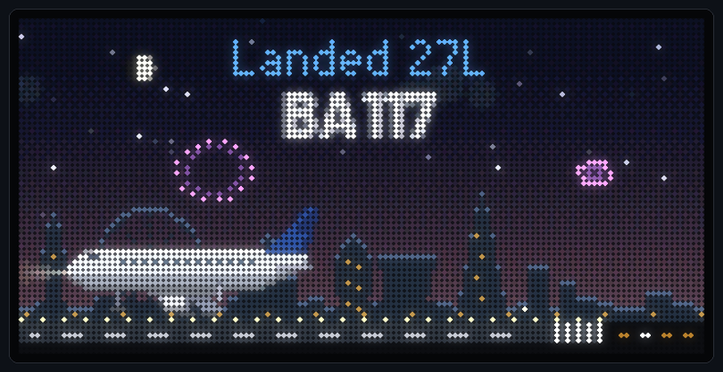
- **Quiet hours**: a dim clock (with the weather and tonight's moon in its
  real phase) overnight when there's no traffic. Night dimming can follow
  the sun instead of fixed times, easing down through dusk and up at dawn.
- **Evening round-up** on your phone at 22:30 (optional): the day's
  movements, busiest hour, top airline, rarest type.
- **Board button** cycles Auto / Map / Arrivals / Stats / Weather.
- **Scanning screen** when nothing is being tracked.

  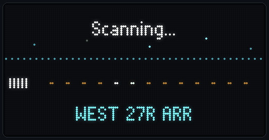
- **Showcase**: a 43-second scripted tour (the button on the web page) for
  showing the board off. While it runs the board pauses its fetches and
  hides the home marker, and each frame is time-stamped, so
  `tools/record_demo.py` records the README GIF in one clean run and
  `tools/record_shots.py` cuts the other README images from it.
- **Web page** on the board: a live mirror of the panel, animation and sky
  previews, a switch for each screen, brightness, night dimming (by the clock
  or following the sun), location and data source settings, the spotter
  (overhead distance, watchlist), phone alerts, Home Assistant, firmware
  updates over Wi-Fi, a log and a health endpoint. Anything that changes the
  board needs a code the panel shows you once.

Twenty aircraft sprites are chosen by ICAO type code (A320, A321, 737, A220,
E-Jet, CRJ, 757, 767, 787, A330, A350, 777, A340, 747, A380, ATR, Q400,
business jet, helicopter, light aircraft), shaded and painted in the
airline's colours for about 45 airlines (colours only, no logos); any other
airline flies white with its logo colour on the fin. The landing and
take-off scenes use larger versions with the gear down. Unknown types fall
back to a grey A320.

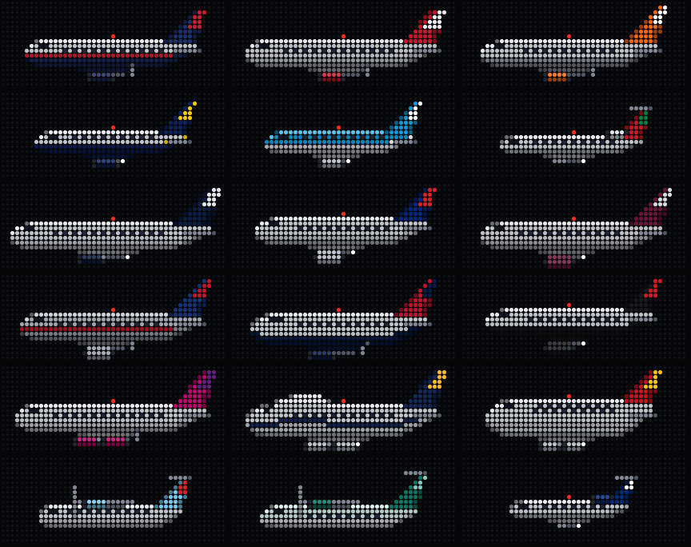

## Hardware

| Part | Notes |
| --- | --- |
| Huidu HD-WF2 controller | ESP32-S3, 8 MB flash (DIO), no PSRAM. Panel on HUB75 port X1. |
| 128×64 HUB75 panel | Tested with a P2.5 (320×160 mm), 1/32 scan. |
| 5 V supply | Powers the board and panel. The board's USB-A port does **not** power it. |
| USB-A to USB-C data cable | For flashing. Many cables are charge-only. |

Other ESP32 boards with a HUB75 panel should work through the original
`esp32dev` environment, but only the HD-WF2 is tested.

## Getting started

### Without building anything

The easiest way is the browser installer at
<https://samhoughton.github.io/Glideslope/> (Chrome or Edge): put the board
in download mode (step 3 below), press Install, then carry on from step 5.

Or by hand:

1. Download `glideslope-<version>-full.bin` from the latest
   [release](../../releases).
2. Put the board into download mode (step 3 below) and write the file at
   address `0x0`, either from Chrome or Edge with
   [esptool-js](https://espressif.github.io/esptool-js/) (Connect, then
   Program at flash address 0x0) or with
   `esptool --chip esp32s3 write-flash 0x0 glideslope-<version>-full.bin`.
3. Carry on from step 5 below.

### Building it yourself

1. Install [PlatformIO](https://platformio.org/) (`pip install platformio`).
2. Copy the example config files and fill in what you need. All of them can
   also be set later from the web page.

   ```bash
   cd firmware/config
   cp UserConfiguration.h.example UserConfiguration.h
   cp APIConfiguration.h.example APIConfiguration.h
   ```

3. **First flash only**: put the HD-WF2 into download mode. With the 5 V supply
   unplugged and USB connected, bridge the two holes on the left edge of the
   module, the round one (GND) and the square one (GPIO0), then plug in the
   5 V. Keep metal away from the 4-pin header below them; its pin by the
   triangle is 5 V. The test button on the board is not a boot button.
4. Build and flash from `firmware/`:

   ```bash
   pio run -e hd_wf2 -t upload
   pio run -e hd_wf2 -t uploadfs
   ```

   After the first flash, uploads work over USB without the bridge.

   If you flash `firmware.bin` with esptool by hand rather than with
   `pio ... -t upload`, also write `boot_app0.bin` at `0xe000` (PlatformIO
   does this for you); otherwise a board that was last updated over Wi-Fi
   keeps booting the older copy.
5. Join the `Glideslope-Setup` Wi-Fi network and enter your home Wi-Fi.
6. Open the board's address in a browser. Positions come from the community
   feeds out of the box; optionally add an OpenSky API client ID and secret
   (free from [opensky-network.org](https://opensky-network.org/)) as the
   last-resort backup.

## Updating

Open the board's web page, choose `firmware.bin` (from a
[release](../../releases), or `firmware/.pio/build/hd_wf2/firmware.bin` from
your own build) under **Firmware**, and press **Install update**. It takes
about 10 seconds and the board restarts into the new version; if anything
goes wrong the old one keeps running. A new version is on trial until it has
fetched positions (or run for five minutes): if it crashes before then, the
board goes back to the previous version by itself.

Anything that changes the board (an update, an airport pack, settings, a
restart) needs the board's **code**. The first time, the page asks for it
and shows it on the panel for 30 seconds; your browser remembers it after
that. The board also answers only to its own names (its address and
`glideslope.local`) and only to its own page, so a web page elsewhere can't
reach it through your browser. Scripts that call the API send
`X-Glideslope: 1` and, for those changes, `X-Glideslope-Token: <code>` (the
tools in `tools/` read the code from `GLIDESLOPE_TOKEN`).

If the board ever restarts unexpectedly, `http://glideslope.local/api/status`
says why (and what each task was doing), and `/api/coredump` gives the
crash's backtrace, to decode with `xtensa-esp32s3-elf-addr2line -pfiaC -e
firmware.elf <addresses>` against that release's build; please include both
in a bug report.

Releases are built by GitHub Actions: pushing a tag such as `v1.0.0` builds
the firmware and attaches `firmware.bin` and the full image to a release.

## Airline logos

Logos are **not included**: they are the airlines' trademarks. Put your own
PNGs, named by ICAO airline code (`BAW.png`, `VIR.png`, ...), in `logos_input/`
and convert them to the board's 32×32 RGB565 format:

```bash
python tools/build_logos_local.py
pio run -e hd_wf2 -t uploadfs
```

Without a logo, the card shows a tile in a default colour with the airline code.

Or add one from the web page: the Display tab lists the airlines the board
has seen without a logo; pick one, choose an image (a PNG with a
transparent background works best), check the 32×32 preview and upload.
The browser does the conversion; the logo goes onto the board, not into
this repository.

<p align="center">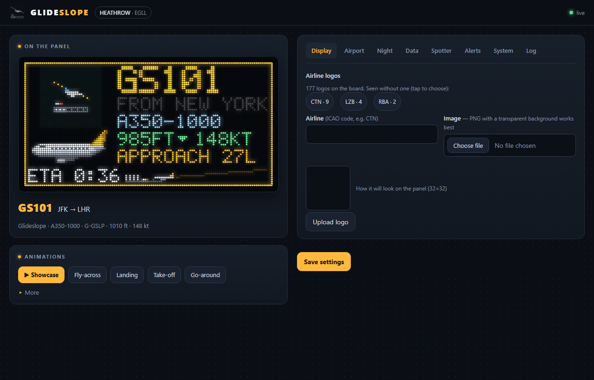</p>

## Other airports

Heathrow is built in. For another airport, install an **airport pack** from
the board's web page: under **Airport**, pick one from the list and press
**Install airport**. Your browser downloads it from this repository and
hands it to the board, which restarts watching that airport. **Centre
search on airport** moves the search area there too, and **Back to
Heathrow** removes the pack.

There are [ready-made packs](packs/) for around fifty of the busiest
airports, from Gatwick, Manchester and Dublin to Schiphol, JFK, Dubai and
Sydney:

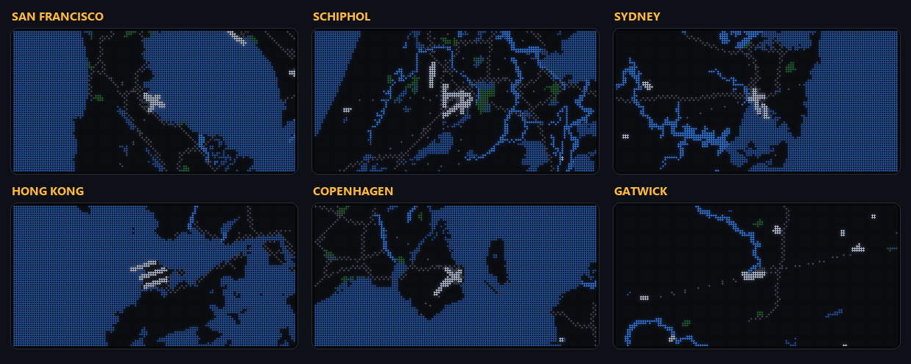

For any other airport, make one yourself:

```bash
python tools/airport_pack.py EGNM --tz Europe/London
```

This writes `EGNM.airport` and a preview PNG; choose it under **…or a pack
file** on the web page. `python tools/build_packs.py` rebuilds the
ready-made set from [`packs/airports.txt`](packs/airports.txt).

The pack holds the airport's position, IATA code, short name, local time
zone, every runway end (threshold, landing direction, displaced thresholds)
and a 128×64 map: the main river or two, large lakes and parks, motorways,
runways, aprons and approach lanes. Runways come from
[OurAirports](https://ourairports.com/data/) (public domain) and the map from
[OpenStreetMap](https://www.openstreetmap.org/copyright) (ODbL) via the
Overpass API. Options: `--name` sets the panel name (12 characters),
`--center lat,lon` centres the map elsewhere (your home, say), and `--tz` can
be left out if the `timezonefinder` package is installed.

Everything follows the pack: approach and departure runway detection, the
arrivals board, the weather station (the airport's own METAR), the map, local
time and the labels. Outside London the landing and take-off scenes use a
generic skyline (hills, hangars, a terminal and a control tower with a
flashing beacon); Heathrow's 15:00 runway alternation applies only to
Heathrow.

## Brand

The logo, wordmark, favicon and social preview are drawn on an LED grid like
the panel, by `tools/brand_workbench.py` (`python tools/brand_workbench.py a`
for the marks, `social` for the preview card); the files are in `brand/`.
The board's web page is `firmware/web/index.html`; the build turns it into
`utils/WebPage.h` (`firmware/scripts/gen_webpage.py`), filling in the logo.
`tools/webui_preview.py` serves the board's web page on your computer with
sample data, for screenshots or for working on the page without a board.

## Editing sprites

Aircraft are generated from each type's proportions (length, nose, fin,
engines, winglets, upper deck...) by `tools/sprite_gen.py`, which also holds
the liveries. Twenty-five types are told apart, down to the A320neo's
bigger engines and sharklets against the A320's, the 737 MAX's split
scimitar winglets and tail cone, and the 777X's folding tips; cargo
airlines fly without cabin windows. Each sprite carries a beacon, a wingtip
strobe and (at scene size) flaps, which the firmware shows when it wants
them: the beacon flashes on the card, and the flaps are out on the approach
and the climb-out. `python tools/sprite_gen.py sheet out.png` renders a
preview sheet and `python tools/sprite_gen.py sheet out.png` renders a preview sheet
and `python tools/sprite_gen.py emit` writes `firmware/display/SpriteData.h`.
The helicopter and light aircraft are hand drawn in `tools/sprite_workbench.py`.
The landing scene's London skyline is generated the same way by
`tools/skyline_workbench.py`, the map's plane icons (three sizes, sixteen
headings) by `tools/icon_workbench.py`, and the type by `tools/gen_fonts.py`
(the Barlow files it reads are fetched separately; see the script).

## Data sources

Aircraft positions, first to answer wins:

1. A local [tar1090](https://github.com/wiedehopf/tar1090) receiver, if set.
2. The open community feeds [adsb.fi](https://adsb.fi/) and
   [adsb.lol](https://adsb.lol/) (ODbL), polled every 5 s; positions are
   usually under a second old. Both are HTTPS only. adsb.fi is asked first,
   over one connection kept open between fetches (a TLS handshake every few
   seconds is more memory than the board can spare), with the reply read one
   aircraft at a time; it is closed briefly whenever something else needs
   HTTPS (the weather every 10 minutes, a route lookup adsb.im can't
   answer). adsb.lol is the backup: since October 2026 it allows 500
   requests a day per address. Can be switched off in the settings.
3. [OpenSky Network](https://opensky-network.org/), every 30 s.

- [adsb.im](https://adsb.im/)'s open route database for routes, over plain
  HTTP; registrations and types come with the positions from adsb.lol.
- [hexdb.io](https://hexdb.io/) (HTTPS) for routes adsb.im doesn't know,
  then OpenSky and AeroAPI if configured.
- [aviationweather.gov](https://aviationweather.gov/) (NOAA) for Heathrow's
  METAR, every 10 minutes.
- FlightAware AeroAPI, optional and paid.
- [ntfy.sh](https://ntfy.sh/) for phone alerts, if a topic is set.
- Built into the firmware: the airport table for city names and the globe
  from [OurAirports](https://ourairports.com/data/) (public domain,
  `tools/gen_airports.py`), and the globe's land from
  [Natural Earth](https://www.naturalearthdata.com/) 1:110m (public domain,
  `tools/gen_landmask.py`).

## Credits and licence

Glideslope builds on
[TheFlightWall_OSS](https://github.com/AxisNimble/TheFlightWall_OSS) and the
forks by biohead and [peterdaley](https://github.com/peterdaley/TheFlightWall_OSS),
and uses [ESP32-HUB75-MatrixPanel-DMA](https://github.com/mrcodetastic/ESP32-HUB75-MatrixPanel-DMA)
and [PubSubClient](https://github.com/knolleary/pubsubclient) (Home Assistant).
The large type is [Barlow](https://github.com/jpt/barlow) by Jeremy Tribby
(SIL Open Font License 1.1), rendered into the firmware as bitmaps.
See [NOTICE](NOTICE) for what changed.

Not affiliated with or endorsed by TheFlightWall or any airline.

Licensed under the [Apache License 2.0](LICENSE).
